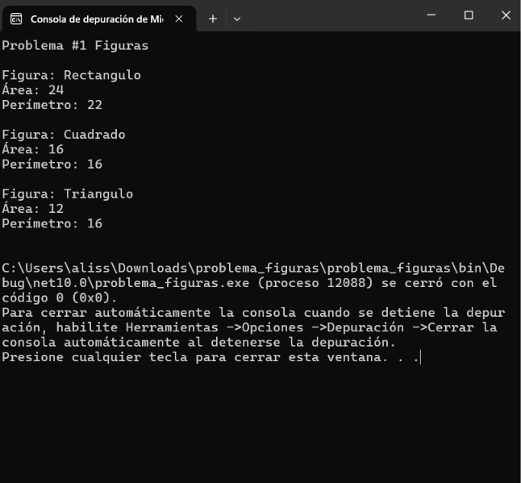
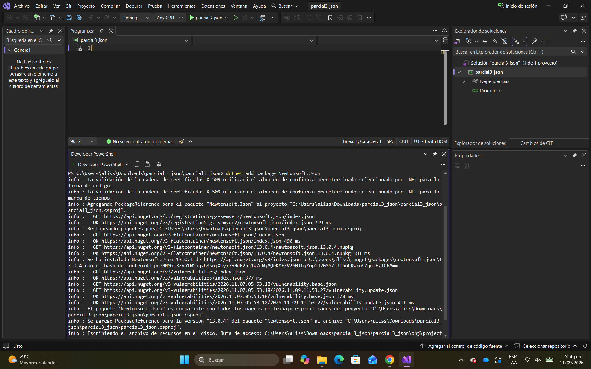
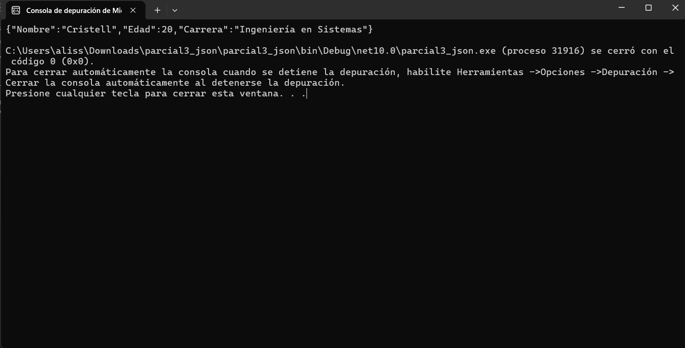
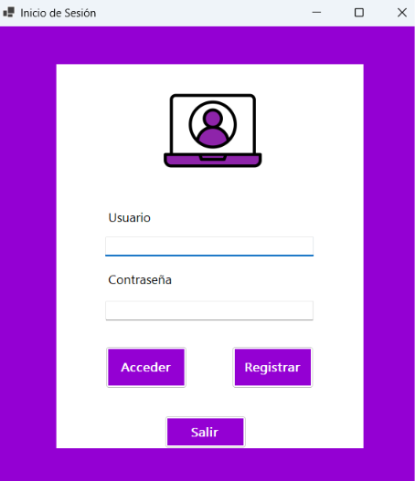
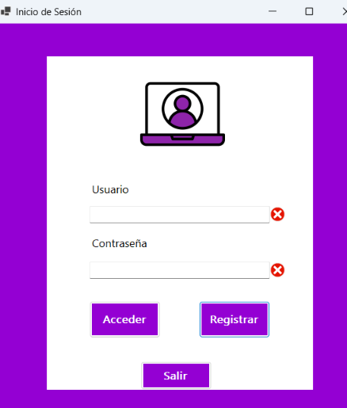
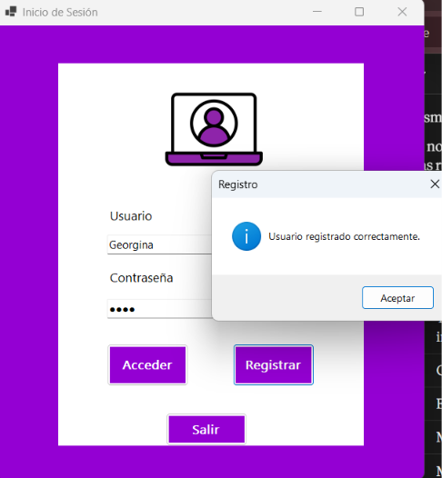
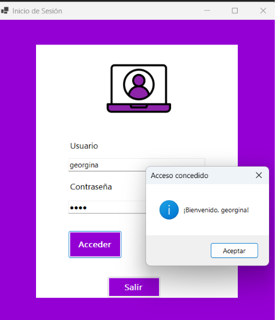
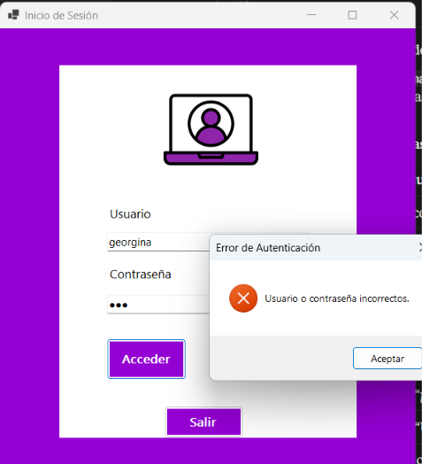
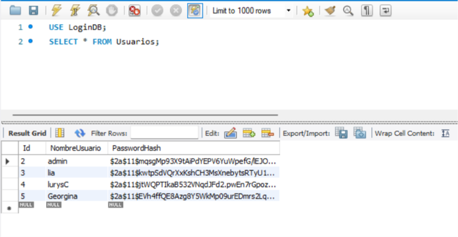
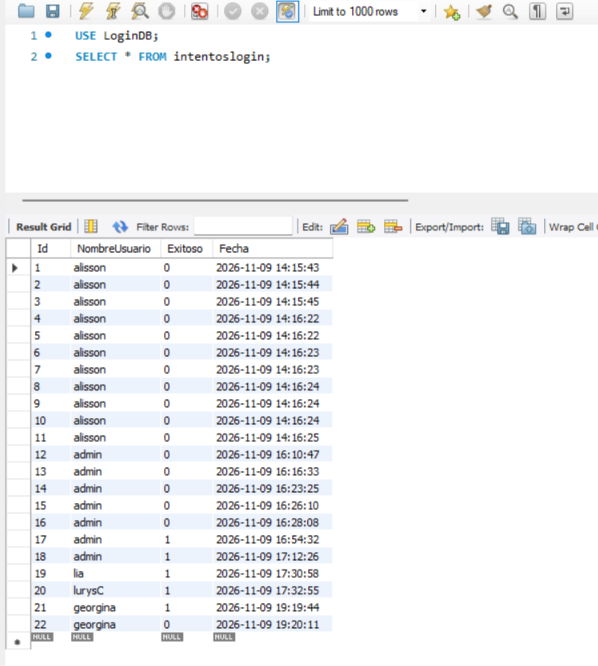

# Parcial #3: Herramientas de la Programación Aplicada III (.NET)

**Fecha:** 09/11/2026

## Contenido del Repositorio

Este repositorio contiene el desarrollo del Parcial #3, que abarca Programación Orientada a Objetos mediante clases abstractas y polimorfismo, serialización de datos con JSON utilizando Newtonsoft.Json, y un sistema de inicio de sesión con almacenamiento seguro de contraseñas mediante el algoritmo BCrypt y una base de datos MySQL.

## Tecnologías Utilizadas

- **Lenguaje / Framework:** C# (.NET)
- **Tipo de Aplicación:** Aplicación de Consola y Windows Forms
- **Base de Datos:** MySQL 8.0
- **Bibliotecas:** Newtonsoft.Json, BCrypt.Net-Next, MySql.Data
- **Herramientas:** Visual Studio, MySQL Workbench, GitHub

## Capturas de Pantalla y Problemas

### Problema 1: Clase Abstracta y Polimorfismo (15 pts)

Implementación de una jerarquía de clases con la clase abstracta `Figura`, que define los métodos abstractos `CalcularArea()` y `CalcularPerimetro()`. Las clases derivadas `Rectangulo`, `Cuadrado` y `Triangulo` implementan dichos métodos. En la clase principal se declara un arreglo unidimensional de tipo `Figura[]` y se recorre mediante un bucle para aplicar polimorfismo, mostrando el nombre de la clase, su área y su perímetro.

**Evidencia de Ejecución**



### Problema 2: JSON con Newtonsoft.Json (15 pts)

Instalación de la biblioteca Newtonsoft.Json mediante el comando `dotnet add package Newtonsoft.Json` y serialización de un objeto con los datos de una persona (Nombre, Edad y Carrera) a una cadena en formato JSON utilizando `JsonConvert.SerializeObject()`.

**Instalación del paquete**



**Evidencia de Ejecución**



### Problema 3: Login con BCrypt (20 pts)

Aplicación de Windows Forms con tres botones (**Acceder**, **Registrar** y **Salir**) que implementa un sistema de login con la biblioteca `BCrypt.Net-Next`.

- **Registrar:** genera el hash de la contraseña con `BCrypt.HashPassword()` y lo guarda en la tabla `Usuarios`.
- **Acceder:** compara la contraseña ingresada contra el hash almacenado con `BCrypt.Verify()` y, si es correcta, muestra un mensaje de bienvenida con el nombre del usuario.
- **Intentos de login:** cada intento, exitoso o fallido, se guarda en la tabla `IntentosLogin` con el usuario y la fecha, para un posible análisis posterior.
- **Validaciones:** si el usuario o la contraseña están vacíos, se muestra un ícono de error (`ErrorProvider`) y no se consulta la base de datos.

**Formulario de inicio de sesión**



**Validación de campos vacíos**



**Registro de usuario**



**Acceso exitoso (muestra el nombre del usuario)**



**Acceso fallido**



**Tabla Usuarios (contraseñas almacenadas como hash)**



**Tabla IntentosLogin (intentos exitosos y fallidos)**



## Estructura de Carpetas o Directorios

```
parcial3/
├── Figuras/                      # Proyecto C#: Clase abstracta y polimorfismo
│   ├── Program.cs                # Clase principal con el arreglo Figura[]
│   ├── Figura.cs                 # Clase abstracta
│   ├── Rectangulo.cs
│   ├── Cuadrado.cs
│   └── Triangulo.cs
├── JsonNewtonsoft/               # Proyecto C#: Serialización con Newtonsoft.Json
│   └── Program.cs
├── LoginBCrypt/                  # Proyecto C#: Login con BCrypt (Windows Forms)
│   ├── Form1.cs                  # Lógica de Acceder, Registrar y Salir
│   └── Program.cs
├── BaseDeDatos/
│   └── LoginDB_backup.sql        # Backup de la BD (tablas Usuarios e IntentosLogin)
├── imagenes_parcial3/            # Capturas de ejecución
│   ├── problema1_ejecucion.png
│   ├── problema2_instalacion.png
│   ├── problema2_ejecucion.png
│   ├── problema3_formulario.png
│   ├── problema3_valores_vacios.png
│   ├── problema3_registro.png
│   ├── problema3_acceso_exitoso.png
│   ├── problema3_acceso_fallido.png
│   ├── problema3_bd_usuarios.png
│   └── problema3_bd_intentos.png
└── README.md                     # Documentación del proyecto
```

## Instrucciones de Ejecución / Uso

**1. Clonar el repositorio:**

```
git clone https://github.com/tu-usuario/parcial-3-csharp.git
```

**2. Restaurar la base de datos (solo para el Problema 3):**

- Abrir MySQL Workbench y conectarse al servidor local.
- Ir a **Server → Data Import**, seleccionar **Import from Self-Contained File** y elegir `BaseDeDatos/LoginDB_backup.sql`.
- Ejecutar la importación. El script crea la base de datos `LoginDB` con las tablas `Usuarios` e `IntentosLogin`.

**3. Configurar la conexión:**

En `LoginBCrypt/Form1.cs`, modificar la cadena de conexión con las credenciales de MySQL de su equipo:

```csharp
private const string cs = "Server=localhost;Port=3306;Database=LoginDB;Uid=root;Pwd=alizn03;";
```

**4. Ejecutar el código:**

- **Problemas 1 y 2 (consola):** navegar al directorio del proyecto (ej. `Figuras` o `JsonNewtonsoft`) y ejecutar `dotnet run`.
- **Problema 3 (Windows Forms):** abrir el proyecto `LoginBCrypt` en Visual Studio y presionar **F5**.

**Credenciales de prueba (Problema 3):**

| Usuario | Contraseña |
|---------|------------|
| admin   | 123        |

También se puede crear un usuario nuevo con el botón **Registrar**.

## Autor

- **Nombre:** Alisson Lacayo
- **Asignatura:** Herramientas de la Programación Aplicada III (.NET)
- **Grupo:** 1IL133
- **Instructor:** Ing. Irina Fong
- **Carrera:** Licenciatura en Ingeniería en Sistemas y Computación
- **Institución:** Universidad Tecnológica de Panamá (UTP)

## Referencias

- Material didáctico del curso Herramientas de la Programación Aplicada III (UTP).
- Documentación de Newtonsoft.Json y BCrypt.Net-Next.
